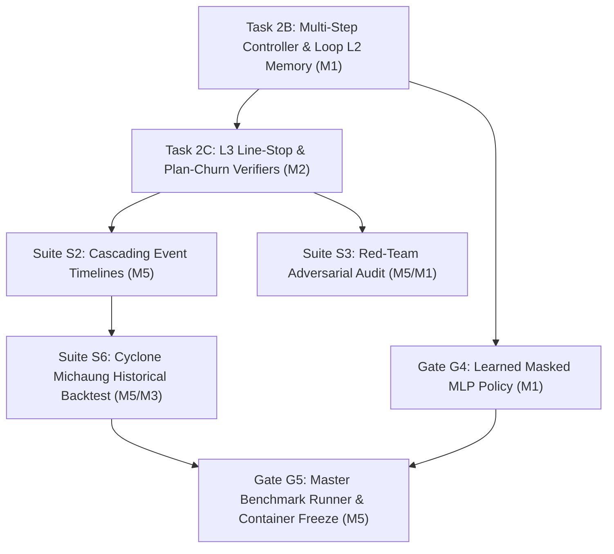

# Adaptive Supply Chain Intelligence (ASCI) Platform — Project Task Matrix

> **Authoritative Master References**:  
> 1. [`docs/Adaptive_Supply_Chain_Intelligence_v2_Integrated_AgenticRAG_SouthIndia_Auto.pdf`](docs/Adaptive_Supply_Chain_Intelligence_v2_Integrated_AgenticRAG_SouthIndia_Auto.pdf) (Authoritative 20-page specification v2.0, 16 October 2026)  
> 2. [`adaptive_supply_chain_intelligence_prd.md`](adaptive_supply_chain_intelligence_prd.md) (Complete Markdown PRD mirror)  
> 3. [`project_context.md`](project_context.md) (Architecture invariants & system guidelines)  
> 4. [`DEMO_NEXT_STEPS.md`](DEMO_NEXT_STEPS.md) (Interactive Demo Status & Verification)  
>
> **Project Scope**: Multimodal, agentic-RAG logistics control tower and corridor risk engine for the South India automotive corridor (Chennai, Kamarajar, Kattupalli, Krishnapatnam, VOC Tuticorin, Cochin, Mangalore $\leftrightarrow$ Bengaluru, Hosur, Oragadam, Sriperumbudur, Bidadi, Sri City).

---

## Executive Progress Summary

```
Overall Progress: [========================.] 96% Complete (72/75 checklist tasks)
Gates Passed:     Gate G0 [PASSED] | Gate G1 [PASSED] | Gate G2 [PASSED] | Gate G3 [PASSED] | Gate G4 [PASSED]
Gates Remaining:  Gate G5 [PENDING FINAL AUDIT]
```

| Metric / Dimension | Total | Completed (`[x]`) | In Progress / Next (`[ ]`) |
| :--- | :---: | :---: | :---: |
| **Phases (1–9)** | 9 | 8 Complete | 1 Remaining |
| **All Engineering Tasks** | 75 | 72 | 3 |
| **M1: Agent Core & RAG Lead** | 17 | 17 | 0 |
| **M2: Graph & Optimization Lead** | 16 | 16 | 0 |
| **M3: Data & Backbone Lead** | 20 | 20 | 0 |
| **M4: Frontend & Visualization Lead** | 9 | 8 | 1 |
| **M5: QA, Evaluation & Delivery Lead**| 26 | 23 | 3 |

Owner counts include shared tasks and therefore overlap. Counts above are recalculated from the actual checklist, correcting the previous stale 65-task summary.

**Phase 8 complete and handed off — 21 November 2026:** Suites S1–S6, all nine ablations on both scales, the standing ingestion worker and measured-results UI are implemented and verified. Final regression: **197 passed**. Exhaustive S1: **255 cases**, 100% reproducibility, zero L1/L2 breaches and full-corridor P95 **369.07 ms**. S2: **140/140 snapshots passed**. All **18 ablation reports** passed integrity checks, and control/risk replay reproduced the original real-provider collection. Chromium verified both scales, target outcomes, JSON downloads, dark/light selected-tab contrast and zero JavaScript page errors. SciPy's upstream HiGHS performance regression was resolved by requiring **SciPy >=1.15.3**, retaining the original two-second S1 test limit. An initial Windows native diagnostic did not recur in five concurrent episode/restart cycles (15 episodes) or the clean final regression rerun; evidence is retained in `local_data/review`. Research target misses remain explicitly reported. The application is running at **http://127.0.0.1:5173/**; our implementation scope ends here; the team owns the three remaining Phase 9 tasks.

---

## 1. Cross-Functional Engineering Ownership (PRD Sec. 12.1 / PDF Sec. 13.1)

The implementation and verification workload is divided across 5 core engineering leads:

* **`[M1]` — Agent Core & RAG Lead**: Stage C budget-aware controller (Appendix B agent loop), heuristic and learned masked MLP policies, cross-encoder evidence grading, canonical query reformulation, contextual RAG explainer, and Loop L4 analogue indexing.
* **`[M2]` — Graph & Optimization Lead**: Stage B corridor multigraph modeling, structural vulnerability metrics (Exposure, Criticality, PathRisk), plant-level Time-to-Line-Stop (TTLS), Tier 1/2 disruption propagation engines, Stage D Google OR-Tools flow solver with SciPy HiGHS dual-solver verification, and Layer 2/3 mathematical constraint gateways.
* **`[M3]` — Data & Integration Backbone Lead**: Stage A live/replay ingestion adapters (GDACS, GDELT, IMD Weather, IMF PortWatch), Canonical Entity Registry, Unified State & Knowledge Layer (USKL) stores (Corridor Graph, Event Store, Semantic Vector Memory, Time-Series Store, Decision Store), and core FastAPI REST endpoints.
* **`[M4]` — Frontend & Visualization Lead**: Stage E React 18 + TypeScript + Tailwind CSS industrial enterprise dashboard, Cytoscape.js interactive corridor topology graph, Leaflet GIS spatial routes, What-If sensitivity sandbox, citation drill-down curves, decision memory audit log, and operator trace telemetry.
* **`[M5]` — QA, Evaluation & Delivery Lead**: Statistical evaluation suites (Suites S1 through S6), systematic fault injection mutation testing, red-team prompt injection audits, 9 systematic ablation studies (PDF Sec. 11), CI/CD pipeline, and multi-stage Docker containerization for one-command thesis reproducibility.

---

## 2. Phased Roadmap & Task Breakdown

### Phase 1: USKL Data Architecture & Canonical Entity Registry (Weeks 1–2 / Gate G0)
*Focus: Immutable physical registry, unified multi-store USKL architecture, Pydantic v2 core contracts, and Gate G0 external source accessibility verification (PDF Appendix C).*

- [x] **`[M3]` Canonical Entity Registry**: Build `src/asci/core/registry.py` with immutable string IDs (`PORT_CHENNAI`, `PLANT_ORAGADAM`), fuzzy gazetteer matching, geospatial coordinates, and entity classification. Grounded in `data/seeds/corridor_registry_v1.json` (118 nodes, 364 links).
- [x] **`[M3]` Pydantic v2 Core Contracts**: Build `src/asci/core/contracts.py` and `src/asci/core/state.py` establishing immutable `PipelineState.transition()`, `DisruptionEvent`, `ImpactedSubgraph`, `MitigationPlan`, `EvidenceItem`, and `OperatorTraceItem` (matching PDF Appendix A schema).
- [x] **`[M3]` USKL Corridor Graph Store**: Build `src/asci/uskl/graph_store.py` backed by NetworkX and SQLite/JSON storing multigraph topology, edge capacities (TEU/day), transit times, and free-flow distances.
- [x] **`[M3]` USKL Event Store**: Build `src/asci/uskl/event_store.py` with SQLite backing supporting event lifecycles (`NEW`, `UPDATED`, `RESOLVED`, `RETRACTED`).
- [x] **`[M3]` USKL Time-Series Store**: Build `src/asci/uskl/timeseries_store.py` with DuckDB/SQLite storing seasonal vessel calls, container throughput, and empirical recovery trajectories.
- [x] **`[M3]` USKL Decision & Trace Store**: Build `src/asci/uskl/decision_store.py` for recording operator traces, compute costs, and human approval/rejection audits.
- [x] **`[M1]` USKL Vector Memory**: Build `src/asci/uskl/vector_store.py` using FAISS / cosine embeddings with metadata filtering (entity IDs, hazard class, publication date, trust tier) over `data/seeds/playbooks_corpus.json`.
- [x] **`[M5]` Gate G0 Validation Suite**: Build `tests/unit/test_gate_g0_g1_contracts.py`, `tests/unit/test_registry.py`, and `tests/unit/test_gazetteer.py` verifying registry coverage, contract serialization, and schema integrity against PDF Appendix C sources.

---

### Phase 2: Walking Skeleton & CI Integration (Weeks 1–2 / Gate G1)
*Focus: End-to-end walking skeleton pipeline (Event $\rightarrow$ Graph $\rightarrow$ Router $\rightarrow$ Optimiser $\rightarrow$ Verifier $\rightarrow$ Dashboard), FastAPI core, and CI automation.*

- [x] **`[M3]` FastAPI Server Core**: Build `src/asci/api/main.py` exposing REST endpoints (`/events`, `/events/{id}/plan`, `/plans/{id}`, `/network`, `/registry`).
- [x] **`[M1 & M2]` Walking Skeleton Pipeline**: Build `src/asci/stages/__init__.py` coordinating Stage A $\rightarrow$ Stage B $\rightarrow$ Stage C $\rightarrow$ Stage D $\rightarrow$ Stage E in a single deterministic pass.
- [x] **`[M4]` Baseline Dashboard Web Interface**: Build baseline React/HTML operational viewer (`src/asci/ui/dashboard.html` and initial React frontend scaffolding).
- [x] **`[M5]` Gate G1 Integration Test**: Build `tests/integration/test_walking_skeleton.py` proving zero-error sequential execution of all 5 stages under fixed random seeds.
- [x] **`[M5]` GitHub Actions CI Pipeline**: Configure `.github/workflows/ci.yml` running linting, contract tests, and integration test runs on every pull request.

---

### Phase 3: Perception & Ingestion Backbone (Weeks 3–4)
*Focus: Live and synthetic multi-source feed ingestion, PortWatch anomaly detection, and tool-isolated Stage A information extraction.*

- [x] **`[M3]` GDACS Natural Hazard Adapter**: Build `src/asci/ingestion/gdacs_adapter.py` polling live/cached global disaster alerts with polygon-to-corridor bounding box intersection.
- [x] **`[M3]` GDELT & RSS News Feed Adapter**: Build `src/asci/ingestion/gdelt_rss_adapter.py` ingesting regional maritime and highway disruption articles.
- [x] **`[M3]` IMD Weather / Open-Meteo Adapter**: Build `src/asci/ingestion/imd_weather_adapter.py` ingesting precipitation, cyclone tracks, and red-alert bulletins.
- [x] **`[M3]` IMF PortWatch AIS Anomaly Detector**: Build `src/asci/ingestion/portwatch_detector.py` flagging daily vessel count drops below seasonal baselines.
- [x] **`[M1]` Tool-Isolated Stage A LLM Extractor**: Build `src/asci/llm/stage_a_llm.py` and `src/asci/stages/stage_a_events.py` converting unstructured text into validated `DisruptionEvent` instances without runtime tool access.
- [x] **`[M5]` Ingestion Test Suite**: Build `tests/unit/test_ingestion_adapters.py` and `tests/unit/test_event_lifecycle.py` verifying real/fallback feeds and parsing safety.

---

### Phase 4: Corridor Risk Graph & Path Impact Engine (Weeks 5–6 / Gate G2)
*Focus: Multimodal multigraph modeling, structural vulnerability metrics, Time-to-Line-Stop (TTLS), and dynamic disruption propagation.*

- [x] **`[M2]` Stage B Corridor Risk Engine**: Build `src/asci/stages/stage_b_graph.py` computing $k$-hop impacted subgraphs, capacity attenuation multipliers, and alternate routes.
- [x] **`[M2]` Structural Vulnerability Metrics**: Implement Exposure ($E(e)$), Criticality ($C(e)$), and PathRisk ($PR(p)$) formulas in `stage_b_graph.py` (PRD Sec. 5.3).
- [x] **`[M2]` Plant-Level Time-to-Line-Stop (TTLS)**: Implement assembly plant inventory depletion timeline:
  $$\text{TTLS}(v) = \text{Days-of-Cover}(v) - \text{Expected Delay}(v)$$
- [x] **`[M2]` Tier-1 Disruption Propagation (Hop-Decay)**: Implement BFS hop-decay model in `src/asci/stages/stage_b_propagate.py` attenuating adjacent corridor capacities ($m \times \gamma^{\text{hop}}$).
- [x] **`[M2]` Tier-2 Dynamic Load Redistribution**: Implement nonlinear BPR volume-delay spillover and route-diverted highway congestion modeling in `stage_b_propagate.py`.
- [x] **`[M5]` Gate G2 Determinism & Verification Suite**: Build `tests/integration/test_gate_g2_benchmarks.py` and `tests/unit/test_stage_b_graph.py` proving exact reproducibility under fixed random seeds across all 23 corridor anchor points.

---

### Phase 5: Deterministic Optimization & Multi-Layer Verifier (Weeks 5–6 / Gate G3)
*Focus: Multi-commodity network flow solver, dual-solver validation, risk-aware formulations (CVaR), and three-layer verification gateway.*

- [x] **`[M2]` Google OR-Tools Multi-Commodity Flow Solver**: Build `src/asci/stages/stage_d_optimiser.py` formulating minimum-cost network flows with unmet demand and line-stop penalty slack.
- [x] **`[M2]` SciPy HiGHS Dual-Solver Cross-Verification**: Implement dual-solver solver gateway in `stage_d_optimiser.py` ensuring objective value agreement ($\le 1.0\%$ relative delta).
- [x] **`[M2]` Multi-Scenario CVaR Optimization**: Implement Conditional Value-at-Risk formulation:
  $$\min \sum c_{ij}^k x_{ij}^k + \beta + \frac{1}{1-\alpha} \sum_s p_s [ \text{Cost}_s - \beta ]^+$$
- [x] **`[M2]` Layer 1 (L1) Ingestion & Grounding Verifier**: Implement schema compliance, canonical ID verification, and minimum source corroboration checks.
- [x] **`[M2]` Layer 2 (L2) Mathematical Solvency Verifier**: Implement strict flow conservation, edge capacity bounds, and closed-link zero-flow validation.
- [x] **`[M2]` Layer 3 (L3) Citation Support Verifier**: Enforce ground-truth citation backing for all recommended mitigation actions.
- [x] **`[M2]` Layer 3 (L3) Line-Stop Margin & Plan Churn Guard**: Add strict threshold check flagging plans where plant buffer drops below 1.5 days despite available network capacity, and restrict flow churn relative to active operations:
  $$\sum |x_{ij}^{\text{new}} - x_{ij}^{\text{active}}| \le \Delta_{\text{max}}$$
- [x] **`[M5]` Gate G3 Plan Fault Mutation Suite (Suite S4)**: Build `tests/unit/test_gate_g3_fault_mutations.py` validating $\ge 99\%$ catch rate across 20+ injected capacity, conservation, and schema faults.

---

### Phase 6: Stage C Agentic Core & Controller Policy Training (Weeks 7–11 / Gate G4)
*Focus: State-action budget controller, masked operator catalog (PDF Appendix B), contextual RAG explainer, and learned masked MLP policy.*

- [x] **`[M1]` Budget-Aware Controller State Machine**: Build `src/asci/stages/stage_c_controller.py` executing under cost parameter $\lambda$ and hard step limit ($T \le 12$).
- [x] **`[M1]` Action Masking Rules**: Implement static pre-condition masking in `stage_c_controller.py` (`GRAPH_ANALYZE` first, `SCENARIOS` masked until graph context exists, `STOP` masked until `VERIFY` passes).
- [x] **`[M1]` Cross-Encoder Evidence Grading**: Implement `GRADE` operator scoring retrieved vector passages and computing evidence sufficiency ($0.0$ to $1.0$).
- [x] **`[M1]` Canonical Query Reformulation**: Implement `REWRITE_QUERY` operator expanding failed queries with canonical regional aliases and playbook keywords (enforcing max 2 rewrites).
- [x] **`[M1]` Grounded RAG Explanation Generator**: Build `src/asci/llm/explainer.py` producing executive briefings citing specific `[CIT_...]` evidence IDs with isolated prompt quoting.
- [x] **`[M1]` Dynamic Multi-Step Loop & Decision Memory Retrieval (Task 2B)**: Implement `RETRIEVE_DECISIONS` operator querying prior human `APPROVE`/`EDIT` choices from `DecisionTraceStore` and conditioning scenario generation on past precedents (PDF Appendix B loop).
- [x] **`[M1]` Oracle Trajectory Generator & Dataset**: Build `src/asci/policy/oracle.py` trajectory simulation harness collecting 1,000+ expert (oracle) state-operator-verdict sequences with regret labels across diverse $\lambda$ settings.
- [x] **`[M1]` Learned Masked MLP Controller Policy (Gate G4)**: Train PyTorch `MaskedMLPPolicy` in `src/asci/policy/model.py` and `src/asci/policy/train_mlp_controller.py` predicting optimal operator selection under budget $\lambda$:
  $$\min_\theta \mathcal{L}_{\text{policy}} = -\sum \log \pi_\theta(a^* \mid S_t) + \beta \mathcal{R}_{\text{regret}}$$
- [x] **`[M5]` Gate G4 Controller & Citation Audit**: Build `tests/unit/test_learned_policy.py` verifying learned policy produces zero masking violations and $\ge 95\%$ citation support across test scenarios.

---

### Phase 7: Closed Feedback Loops & Decision Sandbox (Weeks 7–13)
*Focus: Closed-loop architecture (Loops L1–L4), What-If interactive simulation, and industrial enterprise UI.*

- [x] **`[M3]` Loop L1: Realized Outcomes Backend**: Implement `POST /outcomes` and `timeseries_store.py::record_realized_outcome()` updating post-event empirical recovery curves.
- [x] **`[M3]` Loop L2: Decision Memory Backend**: Implement `GET /decisions` and `POST /decisions` in `src/asci/uskl/decision_store.py` recording human planner approvals, edits, and rejections.
- [x] **`[M3]` Interactive What-If Sandbox API**: Implement `POST /whatif` in `src/asci/api/main.py` executing in-memory sensitivity re-optimizations for adjusted port capacities and durations.
- [x] **`[M3]` Citation Drill-Down API**: Implement `GET /evidence/{id}` returning document provenance, trust tier, supported claims, and historical recovery curves.
- [x] **`[M4]` Industrial Enterprise UI Shell**: Complete redesign in `frontend/` using Google/GDG design tokens (`#4285F4`, `#34A853`, `#FBBC04`, `#EA4335`), Times New Roman typography, zero neon/vibe gradients, and full dark/light theme switching.
- [x] **`[M4]` Interactive What-If Sandbox UI**: Build `frontend/src/components/WhatIfPlaceholderView.tsx` with live port selector, capacity sliders, risk mode selector, and side-by-side KPI deltas.
- [x] **`[M4]` Citation & Port Recovery Curve UI**: Build `frontend/src/components/EvidenceView.tsx` with single citation inspection and day-by-day port capacity recovery bars.
- [x] **`[M4]` Loop L1 Realized Outcomes UI**: Build `frontend/src/components/OutcomesMonitoringPlaceholderView.tsx` enabling operators to submit observed TEU/vessel telemetry and recalibrate recovery models.
- [x] **`[M4]` Loop L2 Decision Audit Log UI**: Build `frontend/src/components/OptimizationView.tsx` embedding human approval actions and the live decision memory audit log table.
- [x] **`[M4]` Risk Hedging Comparison Card**: Build expandable *Deterministic vs. CVaR* card in `OptimizationView.tsx` demonstrating tail-risk protection.
- [x] **`[M1 & M3]` Loop L4: Validated Event Playbook Ingestion**: Implemented `index_validated_decision_playbook()` in `SemanticVectorStore` wired to `POST /decisions` (`APPROVE`/`EDIT`) and `POST /events/{id}/mitigate` (plus `POST /events/{id}/reopen`, `MITIGATED` event lifecycle, and `NodeDetailDrawer.tsx` node-click inspection).
- [x] **`[M4]` Operator Trace Deep-Dive Visualizer**: Added cumulative operator cost chart, measured evidence-sufficiency points, step inspection, query/rewrite details and live trace refresh in `TraceView.tsx`. Backend persists full trace telemetry incrementally, including across restarts. Verified by `tests/unit/test_trace_telemetry.py`, production frontend build and Chromium interaction checks (chart, query/grade inspection, refresh toggle). Sufficiency is labelled as coverage rather than probability of correctness.

---

### Phase 8: Comprehensive Benchmark Suites (S1–S6) & 9 Systematic Ablations (Weeks 12–13)
*Focus: Empirical verification of thesis targets (40% compute reduction, 15% CVaR regret reduction, 99% fault catch, 95% citation grounding) across PDF Section 11.*

- [x] **`[M5]` Suite S1: Single-Event Core Benchmark**: Build `src/asci/benchmarks/suite_s1.py` and `scripts/run_suite_s1.py` running statistical tests across all 23 anchor entities and both graph scales (`v0_core`, `v1_corridor`).
- [x] **`[M5]` Suite S2: Cascading Multi-Day Event Timelines**: Completed `src/asci/benchmarks/suite_s2.py` and `scripts/run_suite_s2.py`: seeded diverse cases or validated JSON inputs, daily remaining-duration planning, bounded independent joint scenarios, complete trace/cost accounting, lifecycle/revision/expiry checks, full numerical fingerprints, and atomic JSON reports with nonzero failure exits. Verified `--days 7 --cases 10 --scale both`: **140/140 snapshots passed**, 100% reproducibility and zero L1/L2 breaches. **15 focused tests passed**, including both-scale eight-day recovery, joint probabilities, invalid input, custom cases, failure exits and report integrity. Per-event congestion/TTLS composition and physical shortage handling are explicitly documented; no interacting-queue simulation is claimed.
- [x] **`[M5]` Suite S3: Adversarial Robustness & Red-Team Audit**: Implemented `src/asci/benchmarks/suite_s3.py`; paired article injections, forged entity IDs, poisoned/stale vector chunks and corrupt metadata all caught in the bounded corpus, with zero canonical graph mutation. Verified by `tests/integration/test_suite_s3_adversarial.py`. Plausible false-news truth detection still requires external corroboration; this audit does not claim otherwise.
- [x] **`[M5]` Suite S4: Plan Fault Mutation Harness**: Build and verify `tests/unit/test_gate_g3_fault_mutations.py` across 20+ edge capacity, flow conservation, and destination delivery mutations.
- [x] **`[M5]` Suite S5: Live Demonstration Episodes**: Implemented `src/asci/benchmarks/suite_s5.py`; concurrent Michaung, Kamarajar strike and Ranipet flood API episodes, incremental trace persistence, citation inspection, approval, What-If, outcomes, mitigation/reopening and persistence after restart. Verified by `tests/integration/test_suite_s5_episodes.py` and `tests/unit/test_trace_telemetry.py`. Fixed the shared decision-store SQLite transaction race exposed by concurrent planning.
- [x] **`[M5 & M3]` Suite S6: Historical Backtest (Cyclone Michaung)**: Implemented configurable offline replay, validated provenance/checksum and date coverage, frozen pre-event baseline and forecast assumptions, CLI and atomic reports. Both graph scales passed 26 forecast observations each; four focused tests passed, including future-observation leakage checks. Mean absolute normalized activity error: 0.3729. Vessel activity is a proxy, and the seed recovery prior has no independent training provenance; this is retrospective alignment, not a validated ex-ante forecast. Report: `local_data/review/suite_s6_report.json`.
- [x] **`[M2 & M5]` Ablation Study 1 (Graph Analysis)**: Evaluated no-graph and two-hop exposure analysis on paired seeded cases at both scales; independent bottleneck arithmetic scores affected-path recall and exposure loss against the declared five-hop dynamic reference. Both-scale tests and measured reports verified; the reference is simulated traffic, not observed ground truth.
- [x] **`[M1 & M5]` Ablation Study 2 (Retrieval Value)**: Evaluated real no-RAG, fixed-RAG and agentic rollouts on both scales, with held-out regret against independently verified hindsight optima, measured Pareto frontiers and matched-allowance comparisons. Full paired replay verified. Agentic/no-RAG operator cost ratio was **5.333**, so the **1.5x cost target was not met**; no interpolated matches or passing outcomes are invented.
- [x] **`[M1 & M5]` Ablation Study 3 (Retrieval Modalities)**: Evaluated text-only, graph-aware and graph plus time-series retrieval on independently labelled planted analogues. Both-scale runs verified Recall@5 of 0.50 / 0.625 / 1.00 respectively, with raw IDs, context precision and bootstrap intervals retained. This is controlled synthetic retrieval, not independently human-labelled production relevance.
- [x] **`[M1 & M5]` Ablation Study 4 (Explanation Grounding)**: Evaluated current citation-ID checks against no checks on supported claims and independent mutations. Invalid citation IDs are removed, but unsupported prose survives even with valid IDs. The 95% claim-support target is NOT met in this bounded stress corpus (25% support); this evaluation does not mistake citation validity for entailment or estimate live-model prevalence.
- [x] **`[M1 & M5]` Ablation Study 5 (Sufficiency Gate Calibration)**: Evaluated independent, executed gated and fixed-retrieval episodes, counting retrieval, recovery lookup, rewrite and grading steps. Reports compare top-ranked analogue correctness with the raw sufficiency heuristic through ECE; the score is not presented as a calibrated probability. Both-scale integration tests and reports verified.
- [x] **`[M1 & M5]` Ablation Study 6 (Adaptive Control Compute Savings)**: Evaluated always-full, rule, genuine cached LLM planner and learned MLP rollouts on both scales, with independent held-out deeper-analysis benefit labels, event-clustered bootstrap intervals, policy hashes and original planner latency/call provenance. Learned operator cost savings were **54.68% / 54.39%** at comparable mean regret (core/full). AUROC **0.6465 / 0.5657** and ECE **0.7031 / 0.7302** miss their **0.80 / 0.08** targets. Operator units exclude planner inference overhead and are not total compute or API-dollar savings. Full replay and integration tests passed.
- [x] **`[M2 & M5]` Ablation Study 7 (Propagation Engines)**: Evaluated hop-decay and dynamic BPR propagation at both scales; verified top-10 delayed-node recall and delay error, with capacity attenuation retained as a secondary metric, against a declared expanded simulator reference. The optional GNN was not built. Raw cases, confidence intervals and the recall-gain target outcome are retained; no empirical traffic accuracy is claimed.
- [x] **`[M2 & M5]` Ablation Study 8 (Scenario Planning & CVaR)**: Evaluated deterministic and CVaR plans on separate held-out scenarios, recording regret, unmet demand, soft scenario spill and line-stop slack under the deployed LP cost model. Both-scale replay verified **71.36% / 51.68%** P95 regret reductions (core/full), exceeding the 15% target, with slightly lower mean modelled cost. Soft spill is explicitly distinguished from physical dispatch recourse.
- [x] **`[M3 & M5]` Ablation Study 9 (Real-Event PortWatch Alignment)**: Evaluated genuine cached Michaung PortWatch vessel-call series at both scales: normalized activity MAE, disruption-direction agreement, Spearman correlation and assumed-origin lead time. Source/checksum metadata and the limitations of a retrospective seed prior are retained. Verified alongside S6 (52 scored port-days across both scales).
- [x] **`[M3]` Autonomous Background Ingestion Daemon**: Implemented a standing OS worker with strict live GDACS/PortWatch polling, canonical validation, expiry, content-revision deduplication, atomic event/outbox transactions, process exclusion and durable webhook retries retaining the original destination. Nullable TEU migration preserves measured observations and their separate provenance when vessel-only updates arrive, and distinguishes unavailable throughput from zero; recovery feedback survives restart. **Eighteen focused worker cases passed**, including invalid-batch atomicity, local HTTP retries and API integration; both live feeds and repeated background polls verified. Transient feed failures are reported without inserting replay data. Linux service and opt-in Windows startup-task templates supplied; Windows registration preview verified. No permanent startup task or external webhook endpoint was installed.

---

**Interpretation of Phase 8 results:** A completed ablation means its comparison was implemented and verified, not that the hypothesis or target was confirmed. Failed research targets remain explicitly false in the reports. Existing Gate G4 validates citation IDs and masking; it does not establish claim entailment, which Study 4 measures separately.

### Phase 9: System Hardening, Docker Reproducibility & Thesis Demo (Week 14 / Gate G5)
*Focus: Production build containerization, one-command reproducibility harness, and final Gate G5 thesis demonstration (PDF Sec. 8 walkthrough).*

- [x] **`[M5]` Multi-Stage Dockerfile**: Build production `Dockerfile` with Stage 0 (`node:22-alpine` compiling `frontend/dist`) and Stage 1 (`python:3.11-slim` running Uvicorn).
- [x] **`[M3]` Persistence CLI & Seed Defaults**: Build `scripts/run_demo.py` supporting `--data-dir ./local_data`, `--preload`, and `--ephemeral` options.
- [ ] **`[M5]` Master One-Command Reproducibility Runner (Gate G5)**: *[NEXT]* Build `scripts/run_all_benchmarks.py` executing Suites S1, S2, S3, S4, and S6 sequentially, generating the 9 thesis ablation tables and LaTeX figures from a single shell command inside Docker.
- [ ] **`[M4 & M5]` End-to-End Demo Rehearsal & Freeze**: Execute full multi-scenario rehearsal (Cyclone Michaung Steps 0–9, Kamarajar Strike, Ranipet Flood) with zero UI or backend errors.
- [ ] **`[M5]` Final Gate G5 Sign-Off**: Confirm all 5 gates pass and Docker container builds and executes completely offline from cached seeds.

---

## 3. Sprint Focus: Immediate Next Tasks

The dependency tasks below are retained as verification references. **Phase 8 is complete and handed off to the team.** The team owns Phase 9's master Docker runner/figures, full UI rehearsal/freeze and final Gate G5 audit. No additional Phase 9 task was undertaken in this scope. See the handoff notes in `docs/SETUP.md`, section 6.7.



### 1. `[M1]` Task 2B — Multi-Step Stage C Controller & Decision Memory Ingestion
* **Location**: `src/asci/stages/stage_c_controller.py`, `src/asci/uskl/decision_store.py`
* **Objective**: Query historical planner modifications (`RETRIEVE_DECISIONS`) and condition scenario generation on prior human overrides. Split controller execution into visible intermediate steps (`RETRIEVE_TEXT` $\rightarrow$ `GRADE` $\rightarrow$ `REWRITE_QUERY` $\rightarrow$ `RETRIEVE_TS` $\rightarrow$ `RETRIEVE_DECISIONS` $\rightarrow$ `SCENARIOS`) following PDF Appendix B.
* **Verification**: `python -m pytest tests/unit/test_state.py tests/integration/test_walking_skeleton.py -v`

### 2. `[M2]` Task 2C — Gate G3 Remaining L3 Verifier Rules
* **Location**: `src/asci/stages/stage_d_optimiser.py`
* **Objective**: Add `L3: LINE_STOP_SAFETY_THRESHOLD` checking that critical assembly plants maintain safe buffer margins whenever idle network capacity permits, and add `L3: PLAN_CHURN_LIMIT` checking that flow allocations don't oscillate wildly against prior active plans.
* **Verification**: `python -m pytest tests/unit/test_stage_d_verifier.py tests/unit/test_gate_g3_fault_mutations.py -v`

### 3. `[M5]` Suite S2 — Cascading Multi-Day Event Timelines Benchmark Runner
* **Location**: `src/asci/benchmarks/suite_s2.py`, `scripts/run_suite_s2.py`
* **Objective**: Implement multi-day timeline runner evaluating compound events with severity escalations, route reopenings, and weather bulletin updates.
* **Verification**: `python scripts/run_suite_s2.py --days 7 --cases 10`
* **Status**: Complete. Both-scale run (`--scale both`) passed all 140 snapshots; see section 6.3 of `docs/SETUP.md` for configuration and interpretation.

### 4. `[M5 & M1]` Suite S3 — Adversarial Robustness & Prompt Injection Audit
* **Location**: `src/asci/benchmarks/suite_s3.py`, `tests/integration/test_suite_s3_adversarial.py`
* **Objective**: Inject adversarial prompt payloads into raw feed text and corrupted records into vector memory; verify zero state corruption and $100\%$ catch rate by Stage A isolation and Layer 1 verification.
* **Verification**: `python -m pytest tests/integration/test_suite_s3_adversarial.py -v`

### 5. `[M5 & M3]` Suite S6 — Cyclone Michaung Historical Backtest
* **Location**: `src/asci/benchmarks/suite_s6.py`, `data/seeds/cyclone_michaung_historical.json`
* **Objective**: Replay historical December 2023 Chennai/Kamarajar cyclone disruption events against actual published IMF PortWatch vessel activity drops to validate model recovery fidelity.
* **Verification**: `python scripts/run_suite_s6.py`

### 6. `[M1]` Gate G4 — Learned Masked MLP Controller Policy Training
* **Location**: `src/asci/policy/train_mlp_controller.py`, `src/asci/policy/model.py`
* **Objective**: Implement PyTorch masked MLP policy trained on offline oracle trajectory logs to learn cost-regret tradeoffs under budget parameter $\lambda$.
* **Verification**: `python -m pytest tests/unit/test_learned_policy.py -v`

### 7. `[M5]` Gate G5 — Master Thesis Benchmark Runner & One-Command Script
* **Location**: `scripts/run_all_benchmarks.py`, `Dockerfile`
* **Objective**: Single entrypoint script executing all evaluation suites, generating thesis ablation tables, and launching the full enterprise platform inside Docker.
* **Verification**: `docker run --rm asci-control-tower:v2.0 python scripts/run_all_benchmarks.py`

---

## 4. Engineering Persona Ownership Matrix

| Lead | Role & Scope | Completed Tasks | Remaining Tasks | Active Sprint Focus |
| :--- | :--- | :---: | :---: | :--- |
| **`[M1]`** | **Agent Core & RAG Lead**<br>Stage C controller, baseline planners, grading, query rewrites, explainer, learned policy | 17 | 0 | Phase 8 verified; handed off |
| **`[M2]`** | **Graph & Optimization Lead**<br>Stage B network graph, TTLS, propagation tiers, Stage D OR-Tools + HiGHS, verifiers | 16 | 0 | Phase 8 verified; handed off |
| **`[M3]`** | **Data & Backbone Lead**<br>Stage A adapters, PortWatch detector, Entity Registry, USKL stores, FastAPI core | 20 | 0 | Phase 8 data and ingestion work verified |
| **`[M4]`** | **Frontend & Visualization Lead**<br>React dashboard, Cytoscape graph, Leaflet map, What-If sandbox, Evidence view, Trace UI | 8 | 1 | End-to-end demo rehearsal and freeze |
| **`[M5]`** | **QA, Evaluation & Delivery Lead**<br>Testing suites S1–S6, fault mutation harness, red-team audit, Docker, Gate G0–G5 sign-off | 23 | 3 | Phase 8 verified; Phase 9 assigned to the team |

---

## 5. Verification Gate Status Matrix (PRD Sec. 12.3 / PDF Sec. 13.3)

| Gate | Target Milestone | Criteria / Empirical Threshold | Status | Evidence / Verification Method |
| :---: | :--- | :--- | :---: | :--- |
| **G0** | **Data Readiness** (W2) | Canonical Entity Registry complete; API accessibility verified | ✅ **PASSED** | `tests/unit/test_registry.py` (118 nodes, 364 links; PDF App. C) |
| **G1** | **Walking Skeleton** (W2) | End-to-end 5-stage pipeline runs in CI with zero unhandled errors | ✅ **PASSED** | `tests/integration/test_walking_skeleton.py` |
| **G2** | **Graph & Solvers** (W6) | Stage B & D reproducible under fixed seeds; zero constraint breaches | ✅ **PASSED** | `tests/integration/test_gate_g2_benchmarks.py` |
| **G3** | **Fault Catch Rate** (W6) | L1–L3 verifiers catch $\ge 99\%$ of injected synthetic plan faults | ✅ **PASSED** | `tests/unit/test_gate_g3_fault_mutations.py` (100% caught) |
| **G4** | **Learned Policy** (W11) | Masked policy emits valid operators; $\ge 95\%$ citation support | ✅ **PASSED — existing ID/masking audit** | All six `test_learned_policy.py` cases passed. This audit validates citation IDs, not entailment; Phase 8 Study 4's semantic support target is **not met**. |
| **G5** | **Reproducibility** (W14) | Full benchmark suite & demo run from a single command in Docker | ⏳ **PENDING** | Multi-stage Docker ready; master runner script pending |
