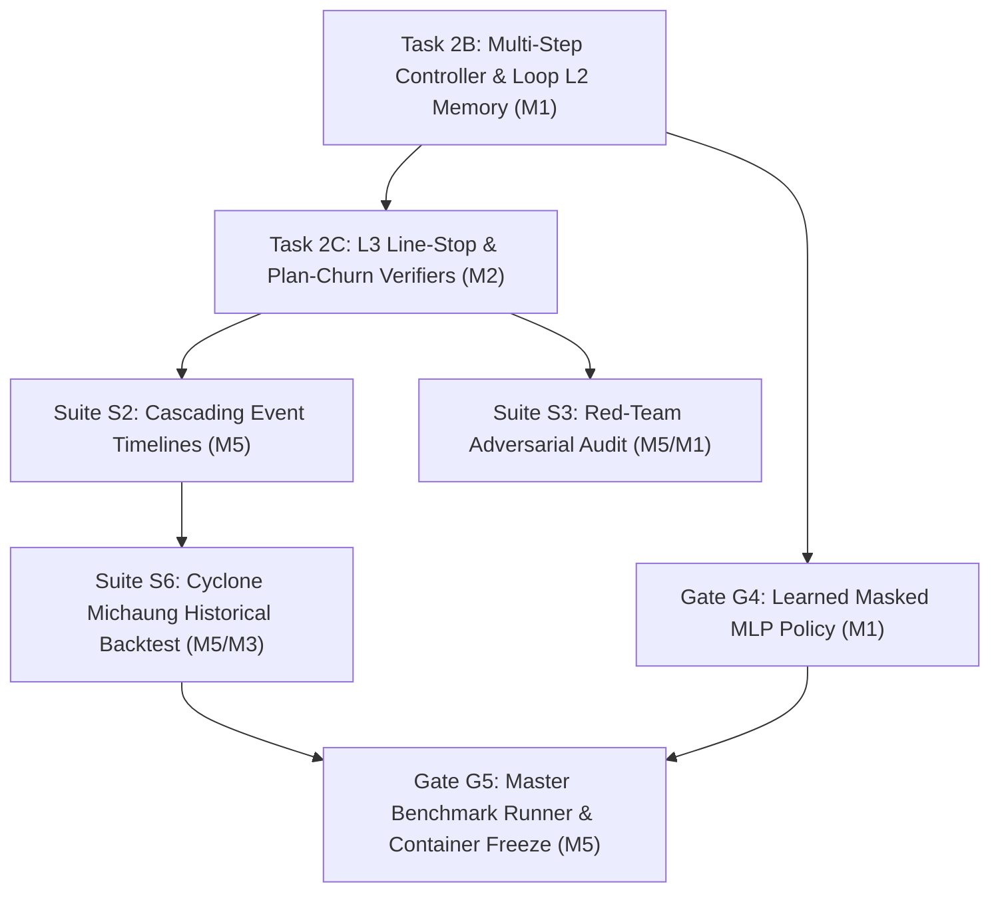

# Adaptive Supply Chain Intelligence (ASCI) Platform — Project Task Matrix

> **Authoritative Master Reference**: [`adaptive_supply_chain_intelligence_prd.md`](adaptive_supply_chain_intelligence_prd.md) (v2.0, 16 October 2026)  
> **Architecture & System Invariants**: [`project_context.md`](project_context.md)  
> **Interactive Demo Status & Verification**: [`DEMO_NEXT_STEPS.md`](DEMO_NEXT_STEPS.md)  
>
> **Project Scope**: Multimodal, agentic-RAG logistics control tower and corridor risk engine for the South India automotive corridor (Chennai, Kamarajar, Kattupalli, Krishnapatnam, VOC Tuticorin, Cochin, Mangalore $\leftrightarrow$ Bengaluru, Hosur, Oragadam, Sriperumbudur, Bidadi, Sri City).

---

## Executive Progress Summary

```
Overall Progress: [=======================>.......] ~75% Complete
Gates Passed:     Gate G0 [PASSED] | Gate G1 [PASSED] | Gate G2 [PASSED] | Gate G3 [PASSED]
Gates Remaining:  Gate G4 [IN PROGRESS] | Gate G5 [PENDING FINAL AUDIT]
```

| Metric / Dimension | Total | Completed (`[x]`) | In Progress / Next (`[ ]`) |
| :--- | :---: | :---: | :---: |
| **Phases (1–9)** | 9 | 5 Complete, 2 Active | 2 Long-Term |
| **All Engineering Tasks** | 56 | 41 | 15 |
| **M1: Agent Core & RAG Lead** | 12 | 8 | 4 |
| **M2: Graph & Optimization Lead** | 12 | 10 | 2 |
| **M3: Data & Backbone Lead** | 11 | 9 | 2 |
| **M4: Frontend & Visualization Lead** | 11 | 9 | 2 |
| **M5: QA, Evaluation & Delivery Lead**| 10 | 5 | 5 |

---

## 1. Cross-Functional Engineering Ownership (PRD Sec. 12.1)

The implementation and verification workload is divided across 5 core engineering leads:

* **`[M1]` — Agent Core & RAG Lead**: Stage C budget-aware controller, heuristic and learned masked MLP policies, cross-encoder evidence grading, canonical query reformulation, contextual RAG explainer, and Loop L4 analogue indexing.
* **`[M2]` — Graph & Optimization Lead**: Stage B corridor multigraph modeling, structural vulnerability metrics (Exposure, Criticality, PathRisk), plant-level Time-to-Line-Stop (TTLS), Tier 1/2 disruption propagation engines, Stage D Google OR-Tools flow solver with SciPy HiGHS dual-solver verification, and Layer 2/3 mathematical constraint gateways.
* **`[M3]` — Data & Integration Backbone Lead**: Stage A live/replay ingestion adapters (GDACS, GDELT, IMD Weather, IMF PortWatch), Canonical Entity Registry, Unified State & Knowledge Layer (USKL) stores (Corridor Graph, Event Store, Semantic Vector Memory, Time-Series Store, Decision Store), and core FastAPI REST endpoints.
* **`[M4]` — Frontend & Visualization Lead**: Stage E React 18 + TypeScript + Tailwind CSS industrial enterprise dashboard, Cytoscape.js interactive corridor topology graph, Leaflet GIS spatial routes, What-If sensitivity sandbox, citation drill-down curves, decision memory audit log, and operator trace telemetry.
* **`[M5]` — QA, Evaluation & Delivery Lead**: Statistical evaluation suites (Suites S1 through S6), systematic fault injection mutation testing, red-team prompt injection audits, CI/CD pipeline, and multi-stage Docker containerization for one-command thesis reproducibility.

---

## 2. Phased Roadmap & Task Breakdown

### Phase 1: USKL Data Architecture & Canonical Entity Registry (Weeks 1–2 / Gate G0)
*Focus: Immutable physical registry, unified multi-store USKL architecture, Pydantic v2 core contracts, and Gate G0 external source accessibility verification.*

- [x] **`[M3]` Canonical Entity Registry**: Build `src/asci/core/registry.py` with immutable string IDs (`PORT_CHENNAI`, `PLANT_ORAGADAM`), fuzzy gazetteer matching, geospatial coordinates, and entity classification. Grounded in `data/seeds/corridor_registry_v1.json` (118 nodes, 364 links).
- [x] **`[M3]` Pydantic v2 Core Contracts**: Build `src/asci/core/contracts.py` and `src/asci/core/state.py` establishing immutable `PipelineState.transition()`, `DisruptionEvent`, `ImpactedSubgraph`, `MitigationPlan`, `EvidenceItem`, and `OperatorTraceItem`.
- [x] **`[M3]` USKL Corridor Graph Store**: Build `src/asci/uskl/graph_store.py` backed by NetworkX and SQLite/JSON storing multigraph topology, edge capacities (TEU/day), transit times, and free-flow distances.
- [x] **`[M3]` USKL Event Store**: Build `src/asci/uskl/event_store.py` with SQLite backing supporting event lifecycles (`NEW`, `UPDATED`, `RESOLVED`, `RETRACTED`).
- [x] **`[M3]` USKL Time-Series Store**: Build `src/asci/uskl/timeseries_store.py` with DuckDB/SQLite storing seasonal vessel calls, container throughput, and empirical recovery trajectories.
- [x] **`[M3]` USKL Decision & Trace Store**: Build `src/asci/uskl/decision_store.py` for recording operator traces, compute costs, and human approval/rejection audits.
- [x] **`[M1]` USKL Vector Memory**: Build `src/asci/uskl/vector_store.py` using FAISS / cosine embeddings with metadata filtering (entity IDs, hazard class, publication date, trust tier) over `data/seeds/playbooks_corpus.json`.
- [x] **`[M5]` Gate G0 Validation Suite**: Build `tests/unit/test_gate_g0_g1_contracts.py`, `tests/unit/test_registry.py`, and `tests/unit/test_gazetteer.py` verifying registry coverage, contract serialization, and schema integrity.

---

### Phase 2: Walking Skeleton & CI Integration (Weeks 1–2 / Gate G1)
*Focus: End-to-end walking skeleton pipeline (Event $\rightarrow$ Graph $\rightarrow$ Router $\rightarrow$ Optimiser $\rightarrow$ Verifier $\rightarrow$ Dashboard), FastAPI core, and CI automation.*

- [x] **`[M3]` FastAPI Server Core**: Build `src/asci/api/main.py` exposing REST endpoints (`/events`, `/events/{id}/plan`, `/plans/{id}`, `/network`, `/registry`).
- [x] **`[M1 & M2]` Walking Skeleton Pipeline**: Build `src/asci/stages/__init__.py` coordinating Stage A $\rightarrow$ Stage B $\rightarrow$ Stage C $\rightarrow$ Stage D $\rightarrow$ Stage E in a single deterministic pass.
- [x] **`[M4]` Baseline Dashboard Web Interface**: Build baseline React/HTML operational viewer (`src/asci/ui/dashboard.html` and initial React frontend scaffolding).
- [x] **`[M5]` Gate G1 Integration Test**: Build `tests/integration/test_walking_skeleton.py` proving zero-error sequential execution of all 5 stages under fixed random seeds.
- [x] **`[M5]` GitHub Actions CI Pipeline**: Configure `.github/workflows/ci.yml` running linting, contract tests, and integration test runs on every pull request.

---

### Phase 3: Perception & Ingestion Backbone (Weeks 3–4)
*Focus: Live and synthetic multi-source feed ingestion, PortWatch anomaly detection, and tool-isolated Stage A information extraction.*

- [x] **`[M3]` GDACS Natural Hazard Adapter**: Build `src/asci/ingestion/gdacs_adapter.py` polling live/cached global disaster alerts with polygon-to-corridor bounding box intersection.
- [x] **`[M3]` GDELT & RSS News Feed Adapter**: Build `src/asci/ingestion/gdelt_rss_adapter.py` ingesting regional maritime and highway disruption articles.
- [x] **`[M3]` IMD Weather / Open-Meteo Adapter**: Build `src/asci/ingestion/imd_weather_adapter.py` ingesting precipitation, cyclone tracks, and red-alert bulletins.
- [x] **`[M3]` IMF PortWatch AIS Anomaly Detector**: Build `src/asci/ingestion/portwatch_detector.py` flagging daily vessel count drops below seasonal baselines.
- [x] **`[M1]` Tool-Isolated Stage A LLM Extractor**: Build `src/asci/llm/stage_a_llm.py` and `src/asci/stages/stage_a_events.py` converting unstructured text into validated `DisruptionEvent` instances without runtime tool access.
- [x] **`[M5]` Ingestion Test Suite**: Build `tests/unit/test_ingestion_adapters.py` and `tests/unit/test_event_lifecycle.py` verifying real/fallback feeds and parsing safety.

---

### Phase 4: Corridor Risk Graph & Path Impact Engine (Weeks 5–6 / Gate G2)
*Focus: Multimodal multigraph modeling, structural vulnerability metrics, Time-to-Line-Stop (TTLS), and dynamic disruption propagation.*

- [x] **`[M2]` Stage B Corridor Risk Engine**: Build `src/asci/stages/stage_b_graph.py` computing $k$-hop impacted subgraphs, capacity attenuation multipliers, and alternate routes.
- [x] **`[M2]` Structural Vulnerability Metrics**: Implement Exposure ($E(e)$), Criticality ($C(e)$), and PathRisk ($PR(p)$) formulas in `stage_b_graph.py` (PRD Sec. 5.2).
- [x] **`[M2]` Plant-Level Time-to-Line-Stop (TTLS)**: Implement assembly plant inventory depletion timeline:
  $$\text{TTLS}(v) = \text{Days-of-Cover}(v) - \text{Expected Delay}(v)$$
- [x] **`[M2]` Tier-1 Disruption Propagation (Hop-Decay)**: Implement BFS hop-decay model in `src/asci/stages/stage_b_propagate.py` attenuating adjacent corridor capacities.
- [x] **`[M2]` Tier-2 Dynamic Load Redistribution**: Implement nonlinear BPR volume-delay spillover and route-diverted highway congestion modeling in `stage_b_propagate.py`.
- [x] **`[M5]` Gate G2 Determinism & Verification Suite**: Build `tests/integration/test_gate_g2_benchmarks.py` and `tests/unit/test_stage_b_graph.py` proving exact reproducibility under fixed random seeds across all 23 corridor anchor points.

---

### Phase 5: Deterministic Optimization & Multi-Layer Verifier (Weeks 5–6 / Gate G3)
*Focus: Multi-commodity network flow solver, dual-solver validation, risk-aware formulations (CVaR), and three-layer verification gateway.*

- [x] **`[M2]` Google OR-Tools Multi-Commodity Flow Solver**: Build `src/asci/stages/stage_d_optimiser.py` formulating minimum-cost network flows with unmet demand and line-stop penalty slack.
- [x] **`[M2]` SciPy HiGHS Dual-Solver Cross-Verification**: Implement dual-solver solver gateway in `stage_d_optimiser.py` ensuring objective value agreement ($\le 1.0\%$ relative delta).
- [x] **`[M2]` Multi-Scenario CVaR Optimization**: Implement Conditional Value-at-Risk formulation:
  $$\min \sum c_{ij}^k x_{ij}^k + \beta + \frac{1}{1-\alpha} \sum_s p_s [ \text{Cost}_s - \beta ]^+$$
- [x] **`[M2]` Layer 1 (L1) Ingestion & Grounding Verifier**: Implement schema compliance, canonical ID verification, and minimum source corroboration checks.
- [x] **`[M2]` Layer 2 (L2) Mathematical Solvency Verifier**: Implement strict flow conservation, edge capacity bounds, and closed-link zero-flow validation.
- [x] **`[M2]` Layer 3 (L3) Citation Support Verifier**: Enforce ground-truth citation backing for all recommended mitigation actions.
- [ ] **`[M2]` Layer 3 (L3) Line-Stop Margin & Plan Churn Guard**: *[NEXT]* Add strict threshold check flagging plans where plant buffer drops below 1.5 days despite available network capacity, and restrict flow churn relative to active operations:
  $$\sum |x_{ij}^{\text{new}} - x_{ij}^{\text{active}}| \le \Delta_{\text{max}}$$
- [x] **`[M5]` Gate G3 Plan Fault Mutation Suite (Suite S4)**: Build `tests/unit/test_gate_g3_fault_mutations.py` validating $\ge 99\%$ catch rate across 20+ injected capacity, conservation, and schema faults.

---

### Phase 6: Stage C Agentic Core & Controller Policy Training (Weeks 7–11 / Gate G4)
*Focus: State-action budget controller, masked operator catalog, contextual RAG explainer, and learned masked MLP policy.*

- [x] **`[M1]` Budget-Aware Controller State Machine**: Build `src/asci/stages/stage_c_controller.py` executing under cost parameter $\lambda$ and hard step limit ($T \le 12$).
- [x] **`[M1]` Action Masking Rules**: Implement static pre-condition masking in `stage_c_controller.py` (`GRAPH_ANALYZE` first, `SCENARIOS` masked until graph context exists, `STOP` masked until `VERIFY` passes).
- [x] **`[M1]` Cross-Encoder Evidence Grading**: Implement `GRADE` operator scoring retrieved vector passages and computing evidence sufficiency ($0.0$ to $1.0$).
- [x] **`[M1]` Canonical Query Reformulation**: Implement `REWRITE_QUERY` operator expanding failed queries with canonical regional aliases and playbook keywords.
- [x] **`[M1]` Grounded RAG Explanation Generator**: Build `src/asci/llm/explainer.py` producing executive briefings citing specific `[CIT_...]` evidence IDs with isolated prompt quoting.
- [ ] **`[M1]` Dynamic Multi-Step Loop & Decision Memory Retrieval (Task 2B)**: *[NEXT]* Implement `RETRIEVE_DECISIONS` operator querying prior human `APPROVE`/`EDIT` choices from `DecisionTraceStore` and conditioning scenario generation on past precedents.
- [ ] **`[M1]` Oracle Trajectory Generator & Dataset**: Build trajectory simulation harness collecting 1,000+ expert (oracle) state-operator-verdict sequences with regret labels.
- [ ] **`[M1]` Learned Masked MLP Controller Policy (Gate G4)**: Train a PyTorch neural policy $\pi_\theta(a \mid S_t)$ predicting optimal operator selection under budget $\lambda$:
  $$\min_\theta \mathcal{L}_{\text{policy}} = -\sum \log \pi_\theta(a^* \mid S_t) + \beta \mathcal{R}_{\text{regret}}$$
- [ ] **`[M5]` Gate G4 Controller & Citation Audit**: Build validation suite verifying learned policy produces zero masking violations and $\ge 95\%$ citation support across test scenarios.

---

### Phase 7: Closed Feedback Loops & Decision Sandbox (Weeks 7–13)
*Focus: Closed-loop architecture (Loops L1–L4), What-If interactive simulation, and industrial enterprise UI.*

- [x] **`[M3]` Loop L1: Realized Outcomes Backend**: Implement `POST /outcomes` and `timeseries_store.py::record_realized_outcome()` updating post-event empirical recovery curves.
- [x] **`[M3]` Loop L2: Decision Memory Backend**: Implement `GET /decisions` and `POST /decisions` in `src/asci/uskl/decision_store.py` recording human planner approvals, edits, and rejections.
- [x] **`[M3]` Interactive What-If Sandbox API**: Implement `POST /whatif` in `src/asci/api/main.py` executing in-memory sensitivity re-optimizations for adjusted port capacities and durations.
- [x] **`[M3]` Citation Drill-Down API**: Implement `GET /evidence/{id}` returning document provenance, trust tier, supported claims, and historical recovery curves.
- [x] **`[M4]` Industrial Enterprise UI Shell**: Complete redesign in `frontend/` using Google/GDG design tokens (`#4285F4`, `#34A853`, `#FBBC04`, `#EA4335`), Times New Roman typography, zero neon/vibe gradients, and full dark/light theme switching.
- [x] **`[M4]` Interactive What-If Sandbox UI**: Build `frontend/src/components/WhatIfPlaceholderView.tsx` with live port selector, capacity sliders, risk mode selector, and side-by-side KPI deltas.
- [x] **`[M4]` Citation & Port Recovery Curve UI**: Build `frontend/src/components/EvidenceView.tsx` with single citation inspection and day-by-day port capacity recovery bars.
- [x] **`[M4]` Loop L1 Realized Outcomes UI**: Build `frontend/src/components/OutcomesMonitoringPlaceholderView.tsx` enabling operators to submit observed TEU/vessel telemetry and recalibrate recovery models.
- [x] **`[M4]` Loop L2 Decision Audit Log UI**: Build `frontend/src/components/OptimizationView.tsx` embedding human approval actions and the live decision memory audit log table.
- [x] **`[M4]` Risk Hedging Comparison Card**: Build expandable *Deterministic vs. CVaR* card in `OptimizationView.tsx` demonstrating tail-risk protection.
- [ ] **`[M1 & M3]` Loop L4: Validated Event Playbook Ingestion**: Implement automated background pipeline indexing resolved disruption profiles and human-signed mitigation plans into `SemanticVectorStore` as new analogue playbooks.
- [ ] **`[M4]` Operator Trace Deep-Dive Visualizer**: *[NEXT]* Enhance `TraceView.tsx` to visualize step-by-step cost vs. information gain trade-offs and query rewrites in real time.

---

### Phase 8: Comprehensive Benchmark Suites (S1–S6) & Ablations (Weeks 12–13)
*Focus: Empirical verification of thesis targets (40% compute reduction, 15% CVaR regret reduction, 99% fault catch, 95% citation grounding).*

- [x] **`[M5]` Suite S1: Single-Event Core Benchmark**: Build `src/asci/benchmarks/suite_s1.py` and `scripts/run_suite_s1.py` running statistical tests across all 23 anchor entities and both graph scales (`v0_core`, `v1_corridor`).
- [ ] **`[M5]` Suite S2: Cascading Multi-Day Event Timelines**: *[NEXT]* Build `src/asci/benchmarks/suite_s2.py` simulating multi-day compound disruptions with sequential event updates, escalations, and weather retractions.
- [ ] **`[M5]` Suite S3: Adversarial Robustness & Red-Team Audit**: *[NEXT]* Build `src/asci/benchmarks/suite_s3.py` injecting false news bulletins, prompt injection payloads, and corrupt vector chunks to verify $0\%$ graph state contamination.
- [x] **`[M5]` Suite S4: Plan Fault Mutation Harness**: Build and verify `tests/unit/test_gate_g3_fault_mutations.py` across 20+ edge capacity, flow conservation, and destination delivery mutations.
- [ ] **`[M5]` Suite S5: Live Demonstration Episodes**: Build replayable end-to-end streaming scenario test harness verifying multi-event concurrent processing.
- [ ] **`[M5 & M3]` Suite S6: Historical Backtest (Cyclone Michaung)**: *[NEXT]* Build `src/asci/benchmarks/suite_s6.py` replaying documented December 2023 Cyclone Michaung data against real historical IMF PortWatch AIS volume drops.
- [ ] **`[M1 & M5]` Adaptive Computation Ablation Study**: Compute empirical cost-regret Pareto frontier comparing adaptive policy against fixed-full and no-RAG baselines (targeting $\ge 40\%$ compute cost reduction).
- [ ] **`[M3]` Autonomous Background Ingestion Daemon**: Implement standing OS-level daemon / background service for polling GDACS and PortWatch feeds with webhook alerts.

---

### Phase 9: System Hardening, Docker Reproducibility & Thesis Demo (Week 14 / Gate G5)
*Focus: Production build containerization, one-command reproducibility harness, and final Gate G5 thesis demonstration.*

- [x] **`[M5]` Multi-Stage Dockerfile**: Build production `Dockerfile` with Stage 0 (`node:22-alpine` compiling `frontend/dist`) and Stage 1 (`python:3.11-slim` running Uvicorn).
- [x] **`[M3]` Persistence CLI & Seed Defaults**: Build `scripts/run_demo.py` supporting `--data-dir ./local_data`, `--preload`, and `--ephemeral` options.
- [ ] **`[M5]` Master One-Command Reproducibility Runner (Gate G5)**: *[NEXT]* Build `scripts/run_all_benchmarks.py` executing Suites S1, S2, S3, S4, and S6 sequentially, generating thesis-ready tables and LaTeX charts.
- [ ] **`[M4 & M5]` End-to-End Demo Rehearsal & Freeze**: Execute full multi-scenario rehearsal (Cyclone Michaung, Kamarajar Strike, Ranipet Flood) with zero UI or backend errors.
- [ ] **`[M5]` Final Gate G5 Sign-Off**: Confirm all 5 gates pass and Docker container builds and executes completely offline from cached seeds.

---

## 3. Sprint Focus: Immediate Next Tasks

These are the immediate engineering tasks required to push the project from the current live prototype state to Gate G4 and Gate G5 completion:



### 1. `[M1]` Task 2B — Multi-Step Stage C Controller & Decision Memory Ingestion
* **Location**: `src/asci/stages/stage_c_controller.py`, `src/asci/uskl/decision_store.py`
* **Objective**: Query historical planner modifications (`RETRIEVE_DECISIONS`) and condition scenario generation on prior human overrides. Split controller execution into visible intermediate steps (`RETRIEVE_TEXT` $\rightarrow$ `GRADE` $\rightarrow$ `REWRITE_QUERY` $\rightarrow$ `RETRIEVE_TS` $\rightarrow$ `RETRIEVE_DECISIONS` $\rightarrow$ `SCENARIOS`).
* **Verification**: `python -m pytest tests/unit/test_state.py tests/integration/test_walking_skeleton.py -v`

### 2. `[M2]` Task 2C — Gate G3 Remaining L3 Verifier Rules
* **Location**: `src/asci/stages/stage_d_optimiser.py`
* **Objective**: Add `L3: LINE_STOP_SAFETY_THRESHOLD` checking that critical assembly plants maintain safe buffer margins whenever idle network capacity permits, and add `L3: PLAN_CHURN_LIMIT` checking that flow allocations don't oscillate wildly against prior active plans.
* **Verification**: `python -m pytest tests/unit/test_stage_d_verifier.py tests/unit/test_gate_g3_fault_mutations.py -v`

### 3. `[M5]` Suite S2 — Cascading Event Timelines Benchmark Runner
* **Location**: `src/asci/benchmarks/suite_s2.py`, `scripts/run_suite_s2.py`
* **Objective**: Implement multi-day timeline runner evaluating compound events with severity escalations, route reopenings, and weather bulletin updates.
* **Verification**: `python scripts/run_suite_s2.py --days 7 --cases 10`

### 4. `[M5 & M1]` Suite S3 — Adversarial Robustness & Prompt Injection Audit
* **Location**: `src/asci/benchmarks/suite_s3.py`, `tests/integration/test_suite_s3_adversarial.py`
* **Objective**: Inject adversarial prompt payloads into raw feed text and corrupted records into vector memory; verify zero state corruption and $100\%$ catch rate by Stage A isolation and Layer 1 verification.
* **Verification**: `python -m pytest tests/integration/test_suite_s3_adversarial.py -v`

### 5. `[M5 & M3]` Suite S6 — Cyclone Michaung Historical Backtest
* **Location**: `src/asci/benchmarks/suite_s6.py`, `data/seeds/cyclone_michaung_historical.json`
* **Objective**: Replay historical December 2023 Chennai/Kamarajar cyclone disruption events against actual published IMF PortWatch vessel activity drops to validate model recovery fidelity.
* **Verification**: `python scripts/run_suite_s6.py`

### 6. `[M1]` Gate G4 — Learned Masked MLP Controller Policy Training
* **Location**: `src/asci/policy/train_mlp_controller.py`, `src/asci/policy/model.py`
* **Objective**: Implement PyTorch masked MLP policy trained on offline oracle trajectory logs to learn cost-regret tradeoffs under budget parameter $\lambda$.
* **Verification**: `python -m pytest tests/unit/test_learned_policy.py -v`

### 7. `[M5]` Gate G5 — Master Thesis Benchmark Runner & One-Command Script
* **Location**: `scripts/run_all_benchmarks.py`, `Dockerfile`
* **Objective**: Single entrypoint script executing all evaluation suites, generating thesis ablation tables, and launching the full enterprise platform inside Docker.
* **Verification**: `docker run --rm asci-control-tower:v2.0 python scripts/run_all_benchmarks.py`

---

## 4. Engineering Persona Ownership Matrix

| Lead | Role & Scope | Completed Tasks | Remaining Tasks | Active Sprint Focus |
| :--- | :--- | :---: | :---: | :--- |
| **`[M1]`** | **Agent Core & RAG Lead**<br>Stage C controller, baseline planners, grading, query rewrites, explainer, learned policy | 8 | 4 | **Task 2B**: Multi-Step Controller & Loop L2 memory lookup (`RETRIEVE_DECISIONS`); Gate G4 learned policy |
| **`[M2]`** | **Graph & Optimization Lead**<br>Stage B network graph, TTLS, propagation tiers, Stage D OR-Tools + HiGHS, verifiers | 10 | 2 | **Task 2C**: L3 Line-Stop margin check & plan churn limit in `stage_d_optimiser.py` |
| **`[M3]`** | **Data & Backbone Lead**<br>Stage A adapters, PortWatch detector, Entity Registry, USKL stores, FastAPI core | 9 | 2 | Loop L4 vector indexing of resolved events; standing ingestion daemon |
| **`[M4]`** | **Frontend & Visualization Lead**<br>React dashboard, Cytoscape graph, Leaflet map, What-If sandbox, Evidence view, Trace UI | 9 | 2 | Step-by-step trace inspection panel; real-time operator cost-tradeoff visualizer |
| **`[M5]`** | **QA, Evaluation & Delivery Lead**<br>Testing suites S1–S6, fault mutation harness, red-team audit, Docker, Gate G0–G5 sign-off | 5 | 5 | **Suite S2**, **Suite S3**, **Suite S6**, and master Gate G5 runner `run_all_benchmarks.py` |

---

## 5. Verification Gate Status Matrix (PRD Sec. 12.3)

| Gate | Target Milestone | Criteria / Empirical Threshold | Status | Evidence / Verification Method |
| :---: | :--- | :--- | :---: | :--- |
| **G0** | **Data Readiness** (W2) | Canonical Entity Registry complete; API accessibility verified | ✅ **PASSED** | `tests/unit/test_registry.py` (118 nodes, 364 links) |
| **G1** | **Walking Skeleton** (W2) | End-to-end 5-stage pipeline runs in CI with zero unhandled errors | ✅ **PASSED** | `tests/integration/test_walking_skeleton.py` |
| **G2** | **Graph & Solvers** (W6) | Stage B & D reproducible under fixed seeds; zero constraint breaches | ✅ **PASSED** | `tests/integration/test_gate_g2_benchmarks.py` |
| **G3** | **Fault Catch Rate** (W6) | L1–L3 verifiers catch $\ge 99\%$ of injected synthetic plan faults | ✅ **PASSED** | `tests/unit/test_gate_g3_fault_mutations.py` (100% caught) |
| **G4** | **Learned Policy** (W11) | Masked policy emits valid operators; $\ge 95\%$ citation support | 🔄 **IN PROGRESS** | Task 2B active; MLP training dataset formulation |
| **G5** | **Reproducibility** (W14) | Full benchmark suite & demo run from a single command in Docker | ⏳ **PENDING** | Multi-stage Docker ready; master runner script pending |
