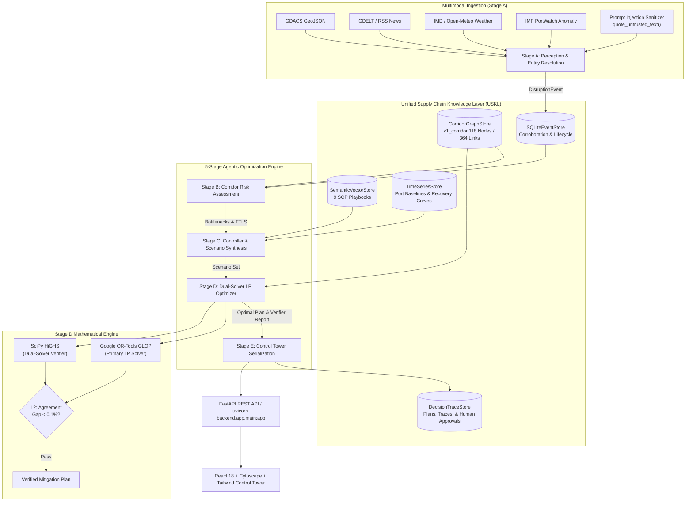

# ASCI Architecture Specification

> **Adaptive Supply Chain Intelligence (ASCI) Platform**  
> Technical Architecture, Dual-Solver Optimization Formulation, & Design System Tokens

---

## 1. High-Level System Architecture

ASCI integrates multimodal disruption sensing, dynamic network risk propagation, vector-grounded playbook retrieval, mathematical multi-commodity flow optimization, and human-in-the-loop decision auditing.

---

## 2. Dual-Scale Corridor Topologies

ASCI models the South India Industrial Corridor with two topological scales:

| Property | `v0_core` (Minimal Baseline) | `v1_corridor` (Production Scaled) |
| :--- | :--- | :--- |
| **Total Nodes** | 23 | 118 |
| **Total Directed Edges** | 42 | 364 |
| **Active Major Ports** | 7 (27,000 TEU/day) | 8 (29,500 TEU/day) |
| **Assembly Plant Demands** | 5,300 TEU/day | 12,470 TEU/day |
| **Calibration Source** | Synthetic Seed Baseline | OpenStreetMap (OSMnx) Calibrated |
| **Intermodal Modes** | Road (NH) | Road (NH/Expressways) + Rail Corridors |
| **Bottleneck Relief** | Constrained | Full alternate diversion connectivity |

---

## 3. 5-Stage Agentic Pipeline Specification

### Stage A: Event Perception & Ingestion
- **Sanitization**: Wraps all untrusted headlines and text inside `<UNTRUSTED_DOCUMENT>` XML boundaries (`quote_untrusted_text()`) to prevent indirect prompt injection attacks.
- **Entity Resolution**: Matches incoming alerts to grounded nodes in the `CanonicalEntityRegistry` using multi-tier resolution:
  1. Exact ID & Alias phrase matching
  2. LRU resolution memory cache
  3. Bounded fuzzy n-gram matching
  4. Haversine coordinate & coastal buffer matching

### Stage B: Corridor Risk Assessment & Congestion Propagation
- **Vulnerability Indices**: Calculates betweenness centrality, corridor concentration, and link uncertainty.
- **Dynamic Propagation**:
  - **Tier-1**: k-hop breadth-first decay across adjacent topological neighbors.
  - **Tier-2**: Bureau of Public Roads (BPR) nonlinear volume-delay congestion function:
    $$t = t_0 \left(1 + \alpha \left(\frac{V}{C}\right)^\beta\right)$$
- **Plant Vulnerability**: Projects Time-to-Line-Stop (TTLS) in operational days based on JIT buffer inventories.

### Stage C: RAG Playbook Retrieval & Scenario Synthesis
- **Retrieval**: Queries `SemanticVectorStore` across 9 curated SOP playbooks (covering Tamil Nadu, Andhra Pradesh, Karnataka, and Kerala) with trust-tier and region filtering.
- **Empirical Recovery**: Queries `TimeSeriesStore` historical post-cyclone and disruption recovery curves.
- **Scenario Synthesis**: Generates 3 discrete operational scenarios (`BEST_CASE`, `EXPECTED`, `WORST_CASE`) with probabilistic demand and capacity multipliers.

### Stage D: Dual-Solver LP Optimization & Verifier
- **Multi-Commodity Formulation**:
  Solves flow allocation $x_{ij}^k$ for each commodity $k \in \{\text{POWERTRAIN\_CKD}, \text{EV\_BATTERY\_PACKS}, \text{BODY\_CHASSIS\_PARTS}\}$:
  $$\min \sum_{(i,j)} \sum_k c_{ij}^k x_{ij}^k + \sum_p \text{Penalty}_p \cdot \text{Unmet}_p$$
- **Dual-Solver Verification**:
  1. Solves primary LP with **Google OR-Tools GLOP**.
  2. Independently solves identical formulation with **SciPy HiGHS**.
  3. Verifies objective gap $< 0.1\%$ under `L2:DUAL_SOLVER_AGREEMENT`.
- **L1–L3 Verification Gates**:
  - `L1: CONSERVATION_OF_FLOW`
  - `L1: CAPACITY_BOUNDS`
  - `L2: DUAL_SOLVER_AGREEMENT`
  - `L2: PER_COMMODITY_DEMAND`
  - `L3: LINE_STOP_SAFETY`

### Stage E: Operational Control Tower & Decision Trace
- Serializes network flows, bottleneck nodes, and diversion routes into Cytoscape JSON and Leaflet GeoJSON.
- Generates an executive briefing with strict citation verification (`[CIT_...]`).
- Persists full execution trace to `DecisionTraceStore` (SQLite + JSONL).

---

## 4. UI/UX Design System Tokens

The application implements a dual-theme architecture supporting the **Primary Dark (Black/Charcoal layered dashboard)** and **Light (Enterprise GDG)** visual identities.

### 4.1. Color System Tokens

| Design Token | Dark Theme (Primary Reference) | Light Theme | Description |
| :--- | :--- | :--- | :--- |
| `--bg-main` | `#090D12` | `#F3F5F7` | Root application canvas |
| `--bg-secondary` | `#111821` | `#F8FAFC` | Sidebar & secondary panel backdrop |
| `--surface-primary` | `#17212D` | `#FFFFFF` | Analytical card & widget background |
| `--surface-elevated` | `#202C39` | `#F1F5F9` | Modals, drawers, and elevated pills |
| `--border-color` | `#2A3948` | `#DFE5EB` | Restrained card & divider borders |
| `--text-primary` | `#F1F5F9` | `#172333` | High-contrast headers & primary values |
| `--text-secondary` | `#A1AFBF` | `#526477` | Descriptive prose & table cells |
| `--text-muted` | `#718096` | `#8C9DAE` | Timestamps & secondary indicators |
| `--accent-cyan` | `#14C8B2` | `#0D9F91` | Primary operational accent & healthy state |
| `--accent-purple` | `#A78BFA` | `#7C3AED` | Multi-commodity & secondary KPI accent |
| `--accent-coral` | `#FB7185` | `#E11D48` | Critical line-stop & disruption warning |
| `--accent-amber` | `#FBBF24` | `#D97706` | At-risk buffer & pending human sign-off |

### 4.2. Typography System
- **Body & UI**: Inter / Geist Sans (`font-sans`)
- **Numerical Telemetry & IDs**: JetBrains Mono (`font-mono`)
- **Weights**: 600–700 for metrics/titles, 400–500 for content.
- **Emoji Policy**: 100% strict prohibition of emojis across UI; all visual iconography is rendered via **Lucide React** SVG vectors.

