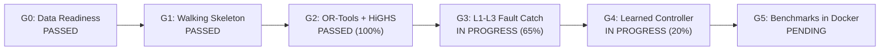

# ASCI Master Plan & Implementation Roadmap

> **Adaptive Supply Chain Intelligence (ASCI) Platform**  
> Roadmap Alignment: Master PRD Contracts & Current Implementation Priorities

---

## 1. Governance & Master Documentation

The ASCI platform is governed by two complementary living documents:

1. **Master Plan / Contract**: [`../adaptive_supply_chain_intelligence_prd.md`](../adaptive_supply_chain_intelligence_prd.md)
   - Comprehensive 9-Phase Product Requirements Document (PRD v2.0).
   - Establishes mathematical invariants, formal contracts, trust-tier criteria, and verification gates (G0–G5).
   - Authoritative specification for core functionality, entity registry boundaries, and loss formulations.

2. **Current Implementation Plan**: [`../DEMO_NEXT_STEPS.md`](../DEMO_NEXT_STEPS.md)
   - Actionable engineering checklist and immediate prototype demo roadmap.
   - Eliminates UI placeholders and drives Priority 1 prototype deliverables (`POST /whatif`, `GET /evidence/{id}`, `POST /outcomes`, `GET /decisions`, Docker multi-stage build).

---

## 2. Milestone Gates Status (PRD Gates G0–G5)

| Milestone Gate | Target Phase | Status | Key Deliverables & Evidence |
| :--- | :--- | :--- | :--- |
| **Gate G0** | W2 (Phase 1) | **PASSED** | Seed data readiness, offline replay fixtures, and graceful HTTP-to-replay failover across GDACS, GDELT, IMD Weather, and IMF PortWatch. |
| **Gate G1** | W2 (Phase 1) | **PASSED** | End-to-end 5-stage Walking Skeleton pipeline executing deterministically via CLI & FastAPI with zero same-second collision. |
| **Gate G2** | W6 (Phase 3) | **PASSED (100%)** | Scaled `v1_corridor` (118 nodes, 364 links) OSMnx topology clearing all 3 v0 bottlenecks; Google OR-Tools GLOP primary LP + SciPy HiGHS dual-solver verification ($< 0.1\%$ gap); multi-commodity flow; Expected-Cost/CVaR; Hypothesis fuzzing; Suite S1 statistical benchmark. |
| **Gate G3** | W6 (Phase 3) | **PARTIAL (65%)** | Active `L2:DUAL_SOLVER_AGREEMENT`, per-commodity demand conservation; pending: `LINE_STOP_SAFETY_THRESHOLD`, `PLAN_CHURN_LIMIT`, and randomized S4 mutation runner. |
| **Gate G4** | W11 (Phase 5) | **PARTIAL (20%)** | `TimeSeriesStore`, `DecisionTraceStore`, BPR Tier-2 `PROPAGATE`, Cytoscape UI; active: interactive `/whatif` simulation, `/outcomes` feedback loop L1, and citation drill-down. |
| **Gate G5** | W14 (Phase 9) | **PENDING** | Full benchmark suites S1–S6 and backtests reproducible via single Docker command. |

---

## 3. Current Implementation Priorities (`DEMO_NEXT_STEPS.md`)

### Priority 1: Prototype Demo Must-Haves (Eliminate UI Placeholders)

- [ ] **Task 1A: Interactive What-If Sandbox (`POST /whatif`)**
  - Add `WhatIfRequest` schema in `src/asci/api/main.py`.
  - Execute `Stage B -> C -> D` in-memory with user-adjusted node capacities and duration without mutating canonical store state.
  - Return simulated vs. baseline cost deltas, rail shift $\%$, and plant TTLS deltas.
  - Wire interactive sensitivity sliders in `frontend/src/components/WhatIfPlaceholderView.tsx`.

- [ ] **Task 1B: Citation Drill-Down & Port Recovery (`GET /evidence/{id}`)**
  - Add `SemanticVectorStore.get_document(citation_id)` in `src/asci/uskl/vector_store.py`.
  - Add `GET /evidence/{citation_id}` endpoint in `src/asci/api/main.py` returning full citation metadata, trust-tier, and matching port recovery curve.
  - Render day-by-day capacity recovery charts on document click in `frontend/src/components/EvidenceView.tsx`.

- [ ] **Task 1C: Realized Outcomes & Loop L1 Calibration (`POST /outcomes`)**
  - Add `TimeSeriesStore.record_realized_outcome()` to log actual port observations.
  - Add `POST /outcomes` endpoint in `src/asci/api/main.py` returning recalibrated recovery curves.
  - Wire interactive calibration form in `frontend/src/components/OutcomesMonitoringPlaceholderView.tsx`.

- [ ] **Task 1D: Visible Decision Memory History (`GET /decisions`)**
  - Add `list_recent_decisions()` in `src/asci/uskl/decision_store.py`.
  - Add `GET /decisions` endpoint in `src/asci/api/main.py`.
  - Render human planner audit history list in the Control Tower.

- [ ] **Task 1E: Demo Persistence Default & Multi-Stage Docker Build**
  - Default `--data-dir` in `scripts/run_demo.py` to `./local_data` to preserve decisions on restart.
  - Update `Dockerfile` to include Node builder stage for `frontend/dist/`.

---

## 4. Non-Negotiable Engineering Invariants

1. **Immutable `PipelineState`**: All state updates must use `state.transition()`.
2. **Canonical Entity IDs Only**: All nodes must validate against `CanonicalEntityRegistry`.
3. **Prompt Injection Boundary**: All untrusted external text must be quarantined via `quote_untrusted_text()`.
4. **Zero Emojis in UI**: Strict adherence to professional enterprise design using Lucide React icons only.
5. **Dual-Solver Verification**: Any production plan must be independently verified by Google OR-Tools GLOP and SciPy HiGHS before sign-off.

